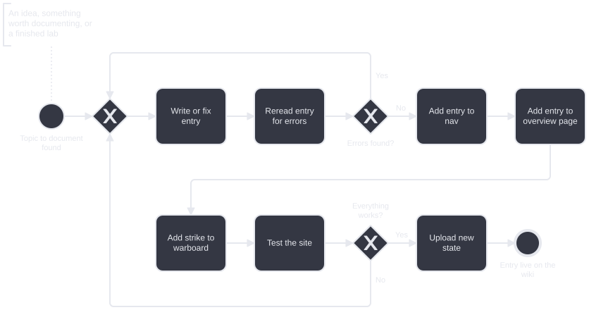

# Publishing Workflow: From Idea to Live Entry

Every page on this wiki goes through the same process, so I modeled it as a BPMN 2.0 diagram.  
I am the only person involved, so it has no pools or lanes. Just the steps, and the two checks that can send me back to fix something.

[](../../assets/bpmn/wiki-entry-process.svg)

*Click to enlarge. [BPMN 2.0 source](../../assets/bpmn/wiki-entry-process.bpmn). Rendered with [bpmn-js](https://bpmn.io).*

## Step by Step

### 1. Find a topic

The process starts when I have something worth writing down. That can be an idea, something I want to document, or a lab I just finished.

### 2. Write the entry

I write the page as a Markdown file in `docs/`. I try to give myself a time limit for this, but I don't have a fixed one.

### 3. Reread it for errors

I read the finished entry again and check it for errors.

- **Errors found:** back to step 2 to fix them, then I reread it.
- **No errors:** on to the next step.

### 4. Add it to the nav

MkDocs builds the site menu from `nav` in `mkdocs.yml`, so the new page gets its own line there:

```yaml
- Publishing Workflow: projects/digital-dojo/03-publishing-workflow.md
```

### 5. Add it to the overview page

The overview page of the section links to the new entry, so it can be found from there as well.

### 6. Add a strike to the warboard

The Completed Strikes list on the [Warboard](../../notes/warboard.md) keeps a short history of the newest pages. The new entry goes on top.

### 7. Test the site

A strict build turns problems like broken internal links into errors:

```bash
./bin/lib/check-build.sh
```

- **Something is broken:** back to step 2. The fix goes through the reread again.
- **Everything works:** on to the upload.

### 8. Upload the new state

```bash
./bin/deploy.sh "Commit message"
```

The script runs the strict build again and stops if it fails. Then it commits and pushes the source to GitHub and publishes the site to GitHub Pages.

### 9. Entry is live

The new entry is on the wiki, and the process is finished.
